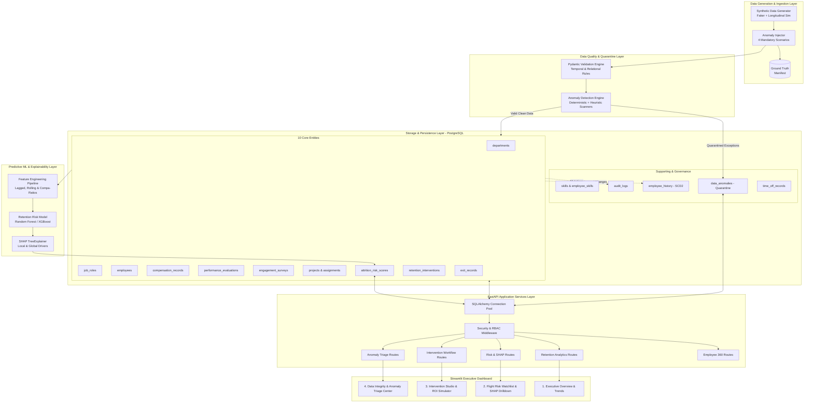
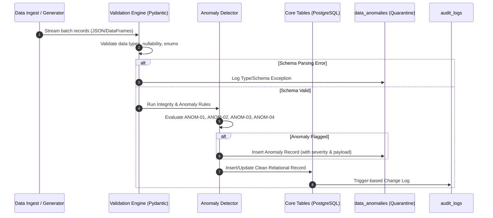
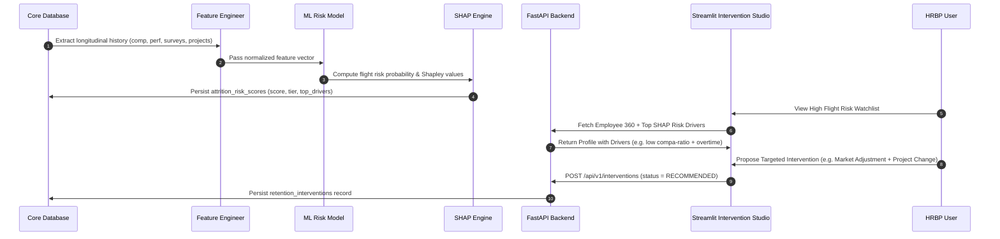

# Workforce Retention Intelligence Platform (WorkforceIQ)
## Enterprise System Architecture Specification

**System Name:** Workforce Retention Intelligence System (`WorkforceIQ`)  
**Organization:** YottaFlex.ai Enterprise Analytics  
**Version:** 1.0.0  
**Phase:** Phase 1 Design Baseline  

---

## 1. High-Level Architecture Topology

The WorkforceIQ platform is built using a modern, decoupled, multi-tier architecture engineered for high-throughput analytical query processing, longitudinal temporal consistency, explainable machine learning inference, and closed-loop retention workflow orchestration.



---

## 2. Multi-Tier Layered Architecture

### 2.1 Layer 1: Data Generation & Ingestion Engine
- **Parametric Demographic Generator:** Simulates organizational growth, hire dates, departmental allocations, skill matrices, and compensation bands.
- **Longitudinal Simulator:** Steps through calendar months simulating real-world workplace dynamics: salary reviews, promotions, performance appraisals, engagement surveys, project allocations, and attrition decisions.
- **Anomaly Injection Core:** Programmatically introduces four specific data corruption/integrity failure scenarios with known ground truth labels for pipeline verification.

### 2.2 Layer 2: Data Quality & Anomaly Quarantine Layer
- **Pydantic Validation Schemas:** Ingestion payloads are parsed through strict Pydantic schemas validating datatypes, required constraints, and enum memberships.
- **Deterministic Anomaly Detectors:** Runs pre-ingestion and post-ingestion rules checking temporal coherence, hierarchical integrity, salary band compliance, and time allocation limits.
- **Quarantine Store (`data_anomalies`):** Ensures that corrupt or anomalous records are either flagged with high-severity exceptions or isolated to prevent training data contamination.

### 2.3 Layer 3: Relational Persistence Layer (PostgreSQL)
- **10 Core Tables:** Normalized relational model enforcing strict referential integrity (`FOREIGN KEY ... REFERENCES ... ON DELETE RESTRICT`).
- **Slowly Changing Dimensions (SCD Type 2):** Historical tracking via `employee_history` with `effective_from`, `effective_to`, and `is_current` boolean flags.
- **Audit Trails (`audit_logs`):** Automatically registers every data mutation with timestamp, acting user/service, changed columns, and previous values.
- **PostgreSQL Views:** Materialized views and virtual views providing pre-aggregated KPIs, real-time watchlist metrics, and anomaly detection checks.

### 2.4 Layer 4: Machine Learning & Explainable AI (XAI)
- **Feature Engineering Pipeline:** Computes critical predictive features:
  - Total tenure and role tenure (months)
  - Compa-ratio: `base_salary / role_midpoint_salary`
  - Time since last promotion and time since last salary increase
  - 3-month and 6-month delta in engagement survey scores
  - Burnout risk indicator and overtime project allocation percentage
  - Manager turnover and reporting hierarchy depth
- **Classification Engine:** Ensembles (Random Forest / Gradient Boosted Trees) trained to predict 90-day and 180-day voluntary turnover probabilities.
- **SHAP Integration:** Evaluates Shapley values for each prediction, attributing exact contribution scores to each feature (e.g., `+0.28 due to below-market compa-ratio`, `+0.18 due to sudden drop in work-life balance`).

### 2.5 Layer 5: Backend Application & API Layer (FastAPI)
- **Framework:** FastAPI utilizing asynchronous ASGI worker model (`uvicorn`).
- **ORM / Query Engine:** SQLAlchemy 2.0 with connection pooling and typed models.
- **Modular REST Routing:**
  - `/api/v1/employees`: Full 360-degree employee view (demographics, history, reviews, projects, comp).
  - `/api/v1/analytics`: Aggregate attrition rates, department heatmaps, retention velocity.
  - `/api/v1/predictions`: Flight risk predictions, risk distribution, SHAP waterfall parameters.
  - `/api/v1/interventions`: Workflow endpoints for proposing, approving, and recording retention interventions.
  - `/api/v1/anomalies`: Anomaly queue, exception summaries, and resolution audit endpoints.

### 2.6 Layer 6: Presentation Layer (Streamlit)
- **Architecture:** Multi-page Streamlit application with customized theme tokens, high-density KPI metric cards, and responsive Plotly charting.
- **Persona Workflows:**
  - **Chief Human Resources Officer (CHRO):** Macro-level turnover trends, voluntary vs involuntary attrition, financial cost of turnover, intervention ROI.
  - **HR Business Partner (HRBP):** Flight risk watchlist, department-level risk clusters, individual SHAP driver breakdowns, intervention proposal wizard.
  - **People Analytics & Operations:** Data integrity audit console, unresolved anomaly triage, pipeline run status.

---

## 3. Data Flow Pipelines

### 3.1 Ingestion & Quarantine Pipeline


### 3.2 Predictive Retention & Intervention Closed Loop


---

## 4. Temporal Modeling & Data Integrity Strategy

### 4.1 Slowly Changing Dimensions (SCD Type 2)
To preserve historical truth and prevent retroactive bias in machine learning models, all mutating employee attributes are versioned using SCD Type 2 semantics:
- **`effective_from` (DATE / TIMESTAMP):** The start timestamp when the attribute state became active.
- **`effective_to` (DATE / TIMESTAMP, NULLABLE):** The expiration timestamp. NULL indicates the currently active record.
- **`is_current` (BOOLEAN):** Quick-filter flag for active state queries.
- **Integrity Rule:** For any given `employee_id`, exactly one record in an SCD2 table can have `is_current = TRUE` and `effective_to IS NULL`. A partial unique index enforces this invariant at the database engine level:
  ```sql
  CREATE UNIQUE INDEX idx_emp_hist_current_unique 
  ON employee_history (employee_id) 
  WHERE is_current = TRUE;
  ```

### 4.2 Bitemporal Timestamp Distinction
To guarantee non-leaking ML training datasets, the architecture strictly distinguishes between:
1. **Valid Time (`effective_from`, `event_date`):** When the event actually occurred in the real world.
2. **Transaction Time (`created_at`, `recorded_at`):** When the system ingested and wrote the record to the database.

---

## 5. Security, Privacy & Compliance Architecture

### 5.1 Role-Based Access Control (RBAC)
The API layer defines four distinct security personas:
- **`EXECUTIVE`:** Read-only access to company-wide aggregates, retention KPIs, anonymized risk distribution.
- **`HRBP`:** Read-write access to department employee 360s, flight risk scores, and retention intervention workflows.
- **`DATA_ENGINEER` / `AUDITOR`:** Read-write access to ingestion pipelines, data anomaly triage, and audit logs.
- **`EMPLOYEE_SELF`:** Restricted read access to own profile, reviews, and time-off balance.

### 5.2 Personally Identifiable Information (PII) Protection
- Direct employee identifiers (Government ID, Personal Email, Emergency Contacts) are stored in restricted columns and masked or excluded from ML feature engineering datasets.
- System generated synthetic data uses pseudonymous identifier formats: `EMP-000001`, `DEP-ENG-01`.

### 5.3 Immutable Audit Logging
The `audit_logs` table functions as an immutable ledger:
- Captures `table_name`, `record_id`, `action` (`INSERT`, `UPDATE`, `DELETE`), `actor_id`, `client_ip`, and JSON diff snapshots (`old_values`, `new_values`).
- Direct updates or deletions on `audit_logs` are forbidden by schema privilege controls.

---

## 6. Non-Functional Requirements & Performance SLAs

| Metric / Dimension | Enterprise SLA / Target | Architectural Mechanism |
| :--- | :--- | :--- |
| **API Response Latency** | P95 < 150ms for analytical queries; P99 < 300ms | Indexed foreign keys, pre-aggregated database views, SQLAlchemy session pooling. |
| **ML Inference Speed** | < 10ms per individual prediction; < 1.5s for batch 5,000 employees | Vectorized NumPy/Scikit-learn pipeline, TreeExplainer optimization. |
| **Data Ingestion Throughput** | >= 2,000 records/sec bulk write | Bulk insert with `COPY` / `pg_bulkload` via psycopg2, disabled non-critical indexes during bulk load. |
| **Data Consistency & ACID** | Zero partial transactions; strict FK referential integrity | PostgreSQL transactional DDL, ACID transaction blocks with auto-rollback on exception. |
| **Scalability Horizon** | Up to 100,000 active employees, 10 years longitudinal history (~50M event rows) | Partitioning ready on event dates (`time_off_records`, `audit_logs`). |
