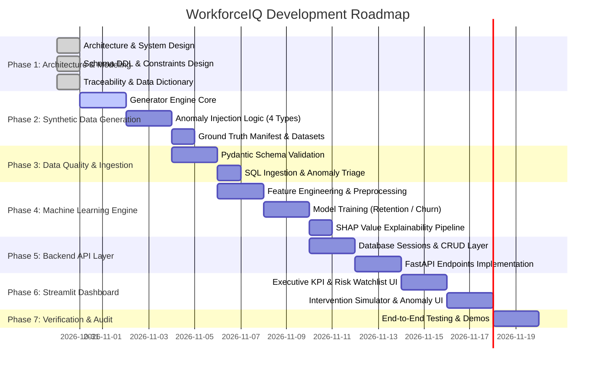

# Workforce Retention Intelligence Platform (WorkforceIQ)
## Comprehensive Implementation Plan

**Organization:** YottaFlex.ai Enterprise Analytics  
**System:** Workforce Retention Intelligence System (`WorkforceIQ`)  
**Version:** 1.0.0  
**Date:** October 2026  
**Status:** In Progress (Phase 1 Active)

---

## 1. Executive Summary & Objectives

The **Workforce Retention Intelligence Platform (`WorkforceIQ`)** is an enterprise-grade artificial intelligence and human capital analytics platform designed to solve critical retention challenges in modern organizations. The platform models complex workforce dynamics, tracks longitudinal employee lifecycle events, identifies high-flight-risk talent through machine learning and explainable AI (SHAP), orchestrates retention interventions, and enforces uncompromising temporal and relational data integrity.

### Primary Objectives:
1. **Holistic Human Capital Modeling:** Capture 10 core organizational entities alongside historical snapshots, bridge entities, audit logs, and anomaly tracking tables.
2. **Temporal & Outcome Integrity:** Implement Slowly Changing Dimensions (SCD Type 2), audit trails, and strict transition guards for employee status, compensation, and separation events.
3. **Proactive Flight Risk Prediction:** Deliver explainable ML models predicting 90-day and 180-day voluntary attrition probabilities with top predictive drivers (SHAP values).
4. **Retention Intervention Workflow:** Provide closed-loop intervention lifecycle management (recommendation, approval, execution, outcome tracking, ROI assessment).
5. **Robust Anomaly Detection:** Programmatically inject, isolate, report, and reconcile four mandatory organizational anomaly patterns (post-termination activity, circular reporting, compensation inversion, and impossible work hours).
6. **Executive & HR Operational Delivery:** Expose high-performance REST APIs via FastAPI and an executive intelligence dashboard built in Streamlit.

---

## 2. Technology Stack & Environment

| Layer | Component / Tool | Version | Purpose |
| :--- | :--- | :--- | :--- |
| **Database** | PostgreSQL / SQLAlchemy Core | 15+ / 2.0+ | Relational schema, temporal SCD2, triggers, check constraints, audit logging |
| **Driver / ORM** | `psycopg2-binary`, `SQLAlchemy` | 2.9+, 2.1+ | Connection pooling, session management, type-safe query generation |
| **Data Generation** | `Faker`, `NumPy`, `Pandas` | 40.4+, 2.5+, 3.1+ | Parametric demographic modeling, attrition distributions, anomaly injection |
| **Data Validation** | `Pydantic v2`, `Pytest` | 2.14+, 9.2+ | Schema validation, business rule enforcement, automated test suites |
| **Machine Learning** | `Scikit-Learn`, `SHAP`, `SciPy` | 1.9+, 0.54+, 1.18+ | Binary classification, survival risk scoring, local & global feature explainability |
| **Backend Services** | `FastAPI`, `Uvicorn` | 0.162+, 0.54+ | OpenAPI-compliant RESTful endpoints, async request handling |
| **Dashboard** | `Streamlit`, `Plotly`, `Altair` | 1.66+, 7.1+, 6.3+ | Executive retention overview, flight risk drill-down, intervention simulator |
| **Configuration** | `python-dotenv` | 1.2+ | Environment configuration (`.env`), database credentials, system flags |

---

## 3. Phased Implementation Roadmap

### Detailed Phase Breakdown

#### Phase 1: Architecture, Data Modeling & Traceability (CURRENT)
- **Goal:** Establish immutable theoretical, logical, and physical foundational specifications.
- **Deliverables:**
  - `IMPLEMENTATION_PLAN.md`: System scope, phasing, dependencies, risk mitigation.
  - `REQUIREMENTS_TRACEABILITY.md`: Bidirectional mapping of business requirements to code and tests.
  - `ARCHITECTURE.md`: High-level system architecture, data flow diagrams, security, and temporal strategy.
  - `docs/data_dictionary.md`: Comprehensive definition of all 10 core entities, bridges, histories, audits, and exceptions.
  - `docs/business_rules.md`: State transition matrices, temporal invariants, intervention protocols, and anomaly rules.
  - `docs/er_diagram.md`: Mermaid relational diagrams and architectural narrative.
  - `database/schema.sql`: ANSI/PostgreSQL DDL script with ENUMs, triggers, views, and strict check constraints.
- **Verification Gate:** Syntactic validation of SQL schema, FK reference graph acyclicity, 100% requirements coverage.

#### Phase 2: Parametric Data Generation & Anomaly Injection
- **Goal:** Generate realistic, longitudinal human capital data (~1,000 to 5,000 employees over a 3-5 year observation window) containing realistic correlations and injected anomalies.
- **Deliverables:**
  - `data_generator/config.py`: Configuration thresholds, seed parameters, role salary bands, turnover rates.
  - `data_generator/demographics.py`: Faker-backed employee demographic and skills generator.
  - `data_generator/longitudinal.py`: Monthly time-stepped simulation of performance ratings, compensation adjustments, projects, and engagement scores.
  - `data_generator/anomalies.py`: Dedicated injection modules for:
    1. Post-termination timesheet / payroll activity.
    2. Circular management hierarchies and orphan nodes.
    3. Compensation out-of-band / grade inversion.
    4. Overlapping approved leave and billable project logging / impossible hours.
  - `data_generator/generator.py`: Master pipeline producing clean datasets and anomaly ground truth manifests.
- **Verification Gate:** Generated data satisfies statistical distributions and produces verifiable ground truth manifests.

#### Phase 3: Data Quality & Schema Ingestion Pipeline
- **Goal:** Enforce rigorous ETL data validation, ingest generated datasets into PostgreSQL, and quarantine anomalies.
- **Deliverables:**
  - `validation/validators.py`: Pydantic models with custom field validators for temporal ordering and enum integrity.
  - `validation/anomaly_detector.py`: Automated scanning engine that isolates injected anomalies into `data_anomalies`.
  - `backend/database.py`: SQLAlchemy engine, session factories, and database initialization utilities.
  - `backend/ingest.py`: Bulk ingestion pipeline with transaction rollbacks and execution logging.
- **Verification Gate:** Zero database constraint violation errors during clean ingest; 100% of injected anomalies identified and logged to the exception table.

#### Phase 4: Machine Learning Retention & Explainability Engine
- **Goal:** Train, validate, serialize, and explain a predictive flight risk model.
- **Deliverables:**
  - `ml/features.py`: Feature engineering pipeline (tenure, salary compa-ratio, time since last promotion, engagement delta, manager turnover, overtime frequency).
  - `ml/train.py`: Model selection (Logistic Regression baseline, Random Forest, Gradient Boosting / XGBoost) with hyperparameter tuning and cross-validation.
  - `ml/explain.py`: SHAP TreeExplainer integration computing global feature importance and individualized local risk factor attributions.
  - `ml/evaluate.py`: Performance metrics reporting (ROC-AUC >= 0.85, Precision-Recall AUC, confusion matrix, calibration curve).
  - `ml/models/`: Serialized model artifacts (`model.joblib`, `scaler.joblib`, `feature_names.json`).
- **Verification Gate:** ROC-AUC >= 0.85 on out-of-time test holdout set; valid SHAP values generated for every prediction.

#### Phase 5: FastAPI Backend Services Layer
- **Goal:** Implement high-performance, secure REST APIs serving analytical queries, risk scores, and management operations.
- **Deliverables:**
  - `backend/main.py`: FastAPI application factory, CORS, exception handlers, and routing.
  - `backend/schemas/`: Pydantic request/response schemas for all endpoints.
  - `backend/routes/employees.py`: Employee 360 profile, historical timeline, skills.
  - `backend/routes/analytics.py`: Organization-level retention rates, turnover heatmaps, department benchmarks.
  - `backend/routes/predictions.py`: Flight risk scores, SHAP explanations, high-risk employee watchlist.
  - `backend/routes/interventions.py`: CRUD operations for retention intervention proposals, approvals, and outcomes.
  - `backend/routes/anomalies.py`: Data exception inspection, audit reports, and manual resolution workflows.
- **Verification Gate:** 100% API test pass rate with pytest; automated OpenAPI documentation available at `/docs`.

#### Phase 6: Streamlit Interactive Dashboard
- **Goal:** Provide human resources business partners (HRBPs) and executive leadership with intuitive visual intelligence.
- **Deliverables:**
  - `dashboard/app.py`: Multi-page navigation, theme settings, session state management.
  - `dashboard/pages/1_Executive_Overview.py`: Company-wide attrition KPIs, voluntary vs involuntary split, turnover trends.
  - `dashboard/pages/2_Flight_Risk_Watchlist.py`: Filterable risk matrix, departmental flight risk heatmaps, SHAP individual drilldowns.
  - `dashboard/pages/3_Intervention_Studio.py`: Retention action simulator, cost-benefit ROI calculator, intervention status board.
  - `dashboard/pages/4_Data_Integrity_Audit.py`: System health dashboard displaying unresolved anomalies across all 4 mandatory scenarios.
- **Verification Gate:** Responsive Streamlit interface with interactive Plotly visual components and sub-second page loads.

#### Phase 7: Verification, Testing & Final Documentation
- **Goal:** Ensure all end-to-end user workflows, system invariants, and non-functional requirements are fully verified.
- **Deliverables:**
  - `tests/test_schema.py`: SQL constraint and trigger verification tests.
  - `tests/test_data_generator.py`: Distribution and anomaly injection verification.
  - `tests/test_ml_pipeline.py`: Model accuracy, stability, and SHAP output checks.
  - `tests/test_api_endpoints.py`: FastAPI route testing using TestClient.
  - `tests/test_business_rules.py`: State transition rules, temporal integrity checks, and anomaly quarantine tests.
  - Comprehensive user guide and deployment instructions in `README.md`.
- **Verification Gate:** Full test suite passes (`pytest`), clean linting, complete requirement traceability verified.

---

## 4. Risk Assessment & Mitigation Matrix

| Risk Event | Severity | Likelihood | Mitigation Strategy |
| :--- | :--- | :--- | :--- |
| **Circular Foreign Key Deadlock** (e.g. Employee reports to Manager who is an Employee) | High | Medium | Allow `manager_id` to be nullable in schema; enforce top-level executive (`manager_id IS NULL`) and validate hierarchy acyclicity via recursive CTEs or ingestion graph checks. |
| **Data Leakage in Attrition Features** (e.g. including exit interview date in risk training) | High | Low | Segregate pre-attrition longitudinal features from post-attrition outcome tables (`exit_records`); enforce observation cutoff dates during feature extraction. |
| **SCD Type 2 Overlap Anomalies** (overlapping `valid_from` and `valid_to` records) | Medium | Medium | Implement PostgreSQL exclusion constraints (`EXCLUDE USING GIST`) or trigger-based pre-commit checks ensuring temporal continuity without overlap. |
| **Model Calibration Drift** (imbalanced attrition distribution skewing probabilities) | Medium | High | Apply SMOTE / Class-weight balancing in training; calibrate predicted probabilities using Platt scaling or Isotonic Regression. |
| **PostgreSQL Connection Exhaustion** in FastAPI | Medium | Low | Configure SQLAlchemy connection pooling with `pool_size=20`, `max_overflow=10`, and context-managed session lifecycles. |

---

## 5. Phase 1 Definition of Done (DoD)

- [x] Comprehensive `IMPLEMENTATION_PLAN.md` detailing all project phases and technical boundaries.
- [x] Exhaustive `REQUIREMENTS_TRACEABILITY.md` connecting business rules, entities, and tests.
- [x] End-to-end `ARCHITECTURE.md` specifying data pipelines, ML framework, API topology, and security.
- [x] Complete `docs/data_dictionary.md` covering 10 core entities, supporting tables, fields, types, and constraints.
- [x] Formalized `docs/business_rules.md` detailing state machines, temporal logic, and 4 anomaly scenarios.
- [x] Detailed `docs/er_diagram.md` containing Mermaid ER diagrams and relational descriptions.
- [x] Syntactically valid, production-ready `database/schema.sql` incorporating ANSI/PostgreSQL DDL, ENUMs, triggers, and views.
- [x] Schema verification script executed to confirm structural integrity and constraint satisfaction.
