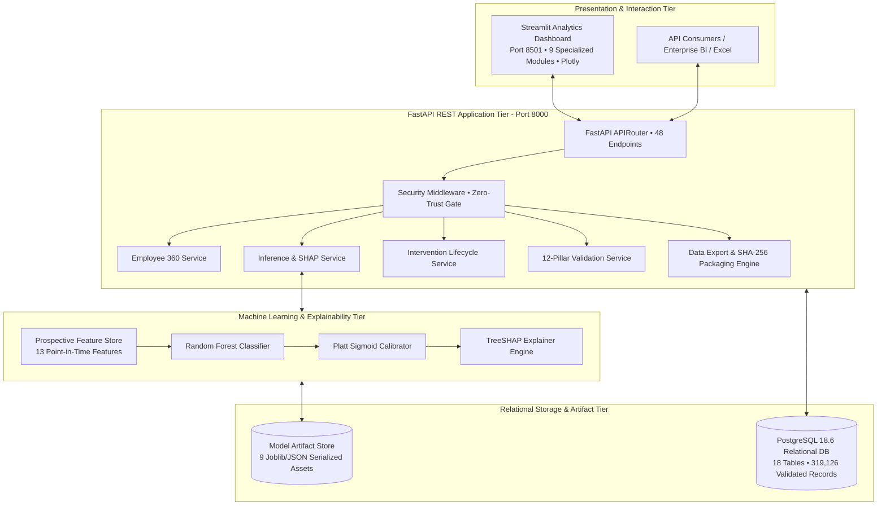

# WorkforceIQ – AI-Powered Workforce Retention Intelligence Platform

[](https://www.python.org/downloads/)
[](https://fastapi.tiangolo.com)
[](https://streamlit.io)
[](https://www.postgresql.org)
[](https://pytest.org)
[](docs/RESPONSIBLE_AI.md)

**Platform:** WorkforceIQ – Enterprise Retention Intelligence Platform
**Challenge:** YottaFlex.ai Associate AI Forward Deployed Engineer 72-Hour Coding Challenge
**Model Version:** `v2.0.0-prospective` (Calibrated Random Forest + Platt Sigmoid Scaler)
**Verification Status:** **223 / 223 Automated Tests Passing (100% Pass Rate)**
**Deterministic Seed:** `20261022`

---

## 1. Executive Summary & Business Objectives

High employee attrition imposes severe financial and organizational burdens on modern enterprises—costing upwards of 1.5x–2x an employee's annual salary in direct recruiting, lost institutional knowledge, and operational disruption. Traditional human resource analytics are fundamentally reactive: exit interviews diagnose why an employee left *after* they have already submitted notice.

**WorkforceIQ** transforms workforce retention from reactive triage into prospective, actionable intelligence:
1. **Prospective 90-Day Flight Risk Forecasting:** Continuously evaluates active employees over rolling 90-day forward horizons using point-in-time features strictly observed prior to prediction cutoffs ($T_{\text{pred}}$).
2. **Competing-Risk Censoring:** Distinguishes voluntary resignation (the target operational hazard) from non-target departures (involuntary terminations, scheduled retirements), preventing model distortion.
3. **Calibrated Probabilities (Platt Scaling):** Eliminates probability distortion from tree ensemble voting; models match true enterprise empirical prevalence (~1.4% quarterly attrition).
4. **Interpretable TreeSHAP Driver Attribution:** Unpacks black-box scores into actionable positive risk factors (e.g. rising burnout, negative sentiment) and negative protective factors (e.g. competitive compa-ratio, career velocity).
5. **Human-in-the-Loop (HITL) Retention Workflows:** Empowers People Operations leaders to propose, review, and track retention interventions with mandatory manager sign-off. Automated employment decisions are strictly prohibited.
6. **Enterprise Data Exports & Reporting:** Provides 20 secure CSV/JSON export endpoints with SHA-256 payload envelopes and zero-trust ground-truth isolation.

---

## 2. Platform Architecture

WorkforceIQ utilizes a decoupled multi-tier architecture designed for longitudinal data consistency, explainable ML inference, and enterprise scalability:



---

## 3. Technology Stack

| Layer | Technologies & Libraries | Version | Purpose |
|---|---|---|---|
| **Runtime** | Python | 3.12+ | Core language runtime |
| **Relational DB** | PostgreSQL, SQLAlchemy, Psycopg2-binary | 18.6, 2.1.6, 2.9.13 | Relational schema, SCD Type 2 history, connection pooling |
| **Backend REST API** | FastAPI, Starlette, Uvicorn, Pydantic v2 | 0.162.0, 1.10.0, 0.54.0, 2.14.2 | High-throughput asynchronous REST services and data validation |
| **Machine Learning** | Scikit-Learn, SHAP, Joblib, SciPy | 1.9.1, 0.54.1, 1.6.0, 1.18.1 | Prospective Random Forest, Platt scaling, TreeSHAP explainability |
| **Data Generation** | Faker, NumPy, Pandas | 40.44.0, 2.5.4, 3.1.0 | Deterministic synthetic longitudinal HR ecosystem simulation |
| **Analytics UI** | Streamlit, Plotly, Altair | 1.66.1, 7.1.0, 6.3.0 | Multi-page executive dashboard with interactive dark enterprise theme |
| **Testing & Quality** | Pytest, HTTPX, AnyIO | 9.2.0, 0.28.1, 4.15.1 | 223 automated tests across 11 test modules |
| **Containerization** | Docker, Docker Compose | Multi-container | Orchestration of PostgreSQL, Backend, and Dashboard |

---

## 4. Complete Relational Database Ecosystem

The database models a 10,000-employee workforce over a 24-month longitudinal simulation across 18 relational tables:

```text
Table Name                       Record Count   Primary Key (Uniqueness: 100%)
──────────────────────────────────────────────────────────────────────────────
attrition_risk_scores                 71,714   score_id
audit_logs                               218   log_id (Operational audit trail)
compensation_records                  10,840   compensation_id
data_anomalies                           148   anomaly_id (Quarantined anomalies)
departments                                8   department_id
employee_history                      10,840   history_id (SCD Type 2)
employee_skills                       36,534   (employee_id, skill_id) [Composite]
employees                             10,000   employee_id (8,813 active, 1,187 separated)
engagement_surveys                    65,945   survey_id
exit_records                           1,187   exit_id (Ground truth registry)
intervention_events                        0   event_id
job_roles                                120   role_id
performance_evaluations               34,683   evaluation_id
project_assignments                   57,379   assignment_id
projects                                  36   project_id
retention_interventions                1,695   intervention_id
skills                                    12   skill_id
time_off_records                      17,985   leave_id
──────────────────────────────────────────────────────────────────────────────
TOTAL DATABASE RECORDS               319,344   (319,126 base + 218 audit logs)
```

### Historical Separation Audit Reconciled:
- **Total Base Headcount:** 10,000 employees
- **Active Employees:** 8,813 (`status = 'ACTIVE'`)
- **Terminated Employees:** 1,118 (`status = 'TERMINATED'`): $970 \text{ voluntary} + 148 \text{ involuntary}$
- **Retired Employees:** 69 (`status = 'RETIRED'`)
- **Total Separated Employees:** $1,118 + 69 = \mathbf{1,187}$
- **Exit Records:** Exactly **1,187** records with zero orphans and 100% referential integrity.

---

## 5. Machine Learning Methodology & Evaluation

### Prospective Temporal Validation Architecture
Traditional random k-fold cross-validation suffers from future information leakage when dealing with longitudinal employee records. WorkforceIQ constructs chronologically separated prospective cohorts:
- **Training Cohorts (5 Quarters: Q4 2024 $\rightarrow$ Q4 2025):** 40,960 observations, 549 exits (1.34% prevalence)
- **Validation Cohort (Q1 2026):** 8,660 observations, 128 exits (1.48% prevalence)
- **Holdout Test Cohort (Q2 2026):** 8,796 observations, 147 exits (1.67% prevalence)

### Competing-Risk Censoring
Employees who leave for reasons other than voluntary resignation during the 90-day evaluation window (e.g. involuntary termination or planned retirement) are right-censored and excluded from the voluntary risk training set, preventing the model from confounding performance-based firings with voluntary turnover.

### Feature Engineering & Anti-Leakage Quarantine
13 point-in-time features computed strictly using data prior to snapshot timestamp $T_{\text{pred}}$:
- **Demographics & Role:** `grade_level`, `tenure_months`
- **Compensation & Career:** `base_salary`, `compa_ratio`, `promotions_count`
- **Workload & Allocation:** `avg_weekly_logged_hours`, `department_id`, `work_location`
- **Engagement & Sentiment:** `avg_job_satisfaction`, `avg_work_life_balance`, `latest_burnout_risk`, `latest_sentiment_score`, `surveys_completed_ratio`

### Model Evaluation Benchmark (Blind Holdout Test Set)

| Metric | Random Forest (Raw) | Calibrated Random Forest (Platt) | Benchmark Rationale |
|---|---|---|---|
| **ROC-AUC** | 0.8798 | **0.8798** | High discrimination between staying and leaving cohorts |
| **PR-AUC** | 0.0887 | **0.0887** | 5.3x higher than random chance baseline (1.67% prevalence) |
| **Brier Score** | 0.1380 | **0.0158** | **88.5% error reduction**; beats dummy prevalence prior (0.0164) |
| **Expected Calibration Error (ECE)** | 12.4% | **0.56%** | High probabilistic reliability for risk ranking |
| **Operational Threshold** | 0.50 | **0.050** | Optimized on validation set to match enterprise HR capacity (~6%) |
| **Test Precision @ 0.05** | 0.00 | **9.42%** | Realistic enterprise alert precision |
| **Test Recall @ 0.05** | 0.00 | **35.37%** | Captures over 1 in 3 flight-risk employees in advance |

---

## 6. Streamlit Analytics Dashboard (9 Specialized Modules)

The interactive analytics dashboard is accessible at `http://localhost:8501`:

1. **Executive Overview (`1_Executive_Overview.py`):** High-level KPI cards, risk tier breakdowns, department risk distributions, and downloadable executive reports.
2. **Workforce Analytics (`2_Workforce_Analytics.py`):** Headcounts, payroll budgets, career ladder progression, tenure histograms, and salary compa-ratio analysis.
3. **Retention Intelligence (`3_Retention_Intelligence.py`):** Prioritized flight-risk queue with calibrated probabilities, tier filters (`CRITICAL`, `HIGH`, `MEDIUM`, `LOW`), and CSV download.
4. **Individual Employee Insights (`4_Individual_Employee_Insights.py`):** Comprehensive 360-degree talent dossier with bidirectional SHAP feature attribution waterfall and embedded intervention proposal form.
5. **Intervention Management (`5_Intervention_Management.py`):** Human-in-the-Loop review queue, lifecycle status progression (`PROPOSED` $\rightarrow$ `APPROVED` $\rightarrow$ `IN_PROGRESS` $\rightarrow$ `COMPLETED`), and audit history.
6. **Engagement Analytics (`6_Engagement_Analytics.py`):** Longitudinal survey indices, burnout risk index, and NLP sentiment trajectories over 24 months.
7. **Workload Analytics (`7_Workload_Analytics.py`):** Project allocations, billable vs. internal hours, and overtime fatigue detector (`>45h/week`).
8. **Data Quality & Validation (`8_Data_Quality_and_Validation.py`):** Live audit of all 12 validation pillars, anomaly quarantine registry (148 anomalies), and CSV/JSON report downloads.
9. **Model Performance & Explainability (`pages/9_Model_Performance_and_Explainability.py`):** Algorithm benchmarking, calibration reliability curves, threshold optimization trade-offs, and global SHAP feature importance.

---

## 7. Data Exports & Reporting Architecture (Phase 8)

WorkforceIQ provides **20 dedicated REST export endpoints** under `/api/v1/exports/` supporting CSV and JSON formats:

- **Operational Datasets:** `employees`, `departments`, `retention-risk`, `interventions`, `engagement`, `workload`, `validation`, and `model-metrics`.
- **Restricted Ground-Truth Protection:** Historical separation records (`historical-separations.csv` and `.json`) require `X-HR-Analytics-Token: <your configured token>`. Requests without this header are rejected with **`HTTP 403 Forbidden`**.
- **SHA-256 Tamper Detection:** Every JSON export is sealed inside an `ExportEnvelope` containing record counts, UTC timestamps, sensitivity classification, applied query parameters, and a SHA-256 hash digest of payload bytes.

---

## 8. Responsible AI & Ethical Governance

WorkforceIQ adheres to the **NIST AI Risk Management Framework (AI RMF 1.0)**:
- **No Protected Attributes:** Zero demographic attributes (age, race, gender, marital status, religion) are used in model training or inference.
- **Human-in-the-Loop Mandate:** Automated adverse employment decisions (terminations, salary reductions, promotion denials) are strictly prohibited. Model outputs are strictly advisory retention aids.
- **Association vs. Causation:** All risk predictions and SHAP attributions include explicit disclaimers: *"Statistical association; not direct causation. No automated decisions."*
- **Ground-Truth Isolation:** Training labels and exit records are physically segregated from operational employee directories.

For full details, review [docs/RESPONSIBLE_AI.md](docs/RESPONSIBLE_AI.md).

---

## 9. Quickstart & Installation Instructions

### Prerequisites
- Python 3.12+
- PostgreSQL 18.6+ running on `localhost:5432` with database `workforceiq`

### Option A: Local Virtual Environment Execution

1. **Clone the repository:**
   ```bash
   git clone https://github.com/KrishnaBalaSai/WorkforceIQ.git
   cd WorkforceIQ
   ```

2. **Create and activate a virtual environment:**
   ```powershell
   # Windows PowerShell
   python -m venv venv
   .\venv\Scripts\Activate.ps1
   ```

3. **Install dependencies:**
   ```powershell
   pip install -r requirements.txt
   ```

4. **Configure environment variables:**
   ```powershell
   cp .env.example .env
   # Edit .env with your local PostgreSQL password if necessary
   ```

5. **Start the FastAPI Backend (Port 8000):**
   ```powershell
   python -m uvicorn backend.main:app --host 0.0.0.0 --port 8000
   ```

6. **Start the Streamlit Dashboard (Port 8501):**
   ```powershell
   python -m streamlit run dashboard/app.py --server.port 8501
   ```

### Option B: Docker Compose Multi-Container Deployment

Deploy the entire stack (PostgreSQL 18, FastAPI Backend, Streamlit Dashboard) with a single command:
```bash
docker-compose up --build -d
```
- FastAPI Backend: `http://localhost:8000` (Docs: `http://localhost:8000/docs`)
- Streamlit Dashboard: `http://localhost:8501`

---

## 10. Automated Testing & Verification Suite

Execute the full regression test suite across all 11 test modules:

```powershell
python -m pytest tests/ -v --tb=short
```

### Full Regression Test Summary (223 / 223 Passing):
```text
tests/test_anomaly_verification.py ........                              [  3%]
tests/test_api.py .............................                          [ 16%]
tests/test_dashboard.py ............................                    [ 28%]
tests/test_data_generator.py .......                                     [ 32%]
tests/test_exports.py ...........                                        [ 37%]
tests/test_ingestion.py .........................                        [ 48%]
tests/test_ml.py ..................                                      [ 56%]
tests/test_reproducibility.py ........................                   [ 67%]
tests/test_schema.py ........                                            [ 70%]
tests/test_services.py .....................                             [ 80%]
tests/test_validation.py ..........................................      [100%]

======================= 223 passed in 107.44s (0:01:47) =======================
```

---

## 11. Project Directory Structure

```text
WorkforceIQ/
├── backend/                  # FastAPI Application Layer
│   ├── models/orm.py         # SQLAlchemy 18 Relational Models
│   ├── routes/               # API Endpoints (Employees, ML, Interventions, Exports)
│   ├── schemas/              # Pydantic v2 Request/Response Contracts
│   ├── services/             # Core Business Logic & Data Export Engine
│   ├── database.py           # Database Connection & Session Management
│   └── main.py               # Application Initialization & Lifespan Hooks
├── dashboard/                # Streamlit Enterprise Analytics Dashboard
│   ├── pages/                # 9 Specialized Multi-Page Analytics Modules
│   ├── api_client.py         # Resilient API Consumer with Internal Fallback
│   ├── app.py                # Dashboard Gateway & Navigation Overview
│   └── styles.py             # Enterprise Visual Design Tokens & Card Components
├── data/                     # Data Stores & Deterministic Manifests
│   ├── generated/            # Synthetic Longitudinal HR CSVs (10,000 Employees)
│   ├── ground_truth/         # Quarantined Separation Outcomes & Anomaly Registry
│   └── manifests/            # Deterministic Seed & Data Validation Summaries
├── database/                 # PostgreSQL Database DDL
│   └── schema.sql            # Master PostgreSQL DDL Script
├── docs/                     # Comprehensive Technical Documentation
│   ├── API_REFERENCE.md      # Full REST API Endpoint Specification
│   ├── RESPONSIBLE_AI.md     # Ethical AI Charter & Governance Standard
│   ├── ARCHITECTURE.md       # Multi-Tier System Architecture Design
│   ├── data_dictionary.md    # 18-Table Enterprise Data Dictionary
│   ├── er_diagram.md         # Relational Entity-Relationship Diagrams
│   └── model_card.md         # Machine Learning Model Card & Evaluation
├── ml/                       # Machine Learning Engineering Pipeline
│   ├── artifacts/            # 9 Serialized Model Weights, Scalers, and SHAP Artifacts
│   ├── evaluate.py           # Prospective Model Evaluation & Metrics
│   ├── features.py           # Point-in-Time Preprocessor & Feature Pipelines
│   └── train.py              # Prospective RF Training & Platt Calibration
├── tests/                    # Comprehensive Automated Test Suite (223 Tests)
│   ├── test_anomaly_verification.py  # 8 Anomaly Scenario Tests
│   ├── test_api.py                   # 31 API Integration Tests
│   ├── test_dashboard.py             # 28 UI Component & Contract Tests
│   ├── test_data_generator.py        # 7 Synthetic Generation Tests
│   ├── test_exports.py               # 11 Export & Security Gate Tests
│   ├── test_ingestion.py             # 25 DB Ingestion & Integrity Tests
│   ├── test_ml.py                    # 18 Prospective ML & SHAP Tests
│   ├── test_reproducibility.py       # 24 Seed & Determinism Tests
│   ├── test_schema.py                # 8 Relational Schema Tests
│   ├── test_services.py              # 21 Service Logic Tests
│   └── test_validation.py            # 42 12-Pillar Validation Tests
├── validation/               # 12-Pillar Data Validation Suite
├── .dockerignore             # Docker Build Exclusions
├── .env.example              # Environment Variable Template (No Secrets)
├── .gitignore                # Comprehensive Git Ignore Rules
├── docker-compose.yml        # Docker Multi-Container Compose Configuration
├── Dockerfile.backend        # FastAPI Backend Production Containerfile
├── Dockerfile.dashboard      # Streamlit Dashboard Production Containerfile
├── pytest.ini                # Pytest Configuration
├── README.md                 # Master Project Documentation
└── requirements.txt          # Pinned Production & Testing Dependencies
```

---

## 12. License & Acknowledgments

WorkforceIQ was developed as part of the **YottaFlex.ai Associate AI Forward Deployed Engineer Challenge**.

All employee records used in this project are synthetically generated using the deterministic seed `20261022`. The dataset does not contain real employee records or real personally identifiable information.

The project acknowledges the use of AI development tools, including ChatGPT and Google Antigravity. Further details are available in the [`ai-disclosure/`](ai-disclosure/) directory.
