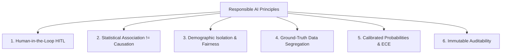

# WorkforceIQ – Responsible AI Charter & Governance Framework

**Platform:** WorkforceIQ – AI-Powered Workforce Retention Intelligence Platform  
**Governance Standard:** IEEE / NIST AI Risk Management Framework (AI RMF 1.0) & EU AI Act High-Risk Employment AI Safeguards  
**Effective Date:** October 30, 2026  
**Status:** Mandatory Operational Policy  

---

## 1. Executive Principles

WorkforceIQ is engineered to assist human managers and People Operations professionals in identifying systemic workplace friction, organizational burnout, and voluntary flight risks. The platform strictly enforces six core Responsible AI pillars:

---

## 2. Principle 1: Human-in-the-Loop (HITL) Mandate

> [!CRITICAL]
> **Automated employment decisions are strictly prohibited.**

1. **No Autonomous Actions:** WorkforceIQ predictions **never** trigger autonomous employment decisions (e.g. compensation cuts, project reassignments, involuntary terminations, or promotion freezes).
2. **Advisory Decision Support:** Model outputs are classified strictly as **advisory decision-support signals** to guide supportive retention interventions.
3. **Mandatory Human Review:** Any retention intervention workflow (e.g., compensation review, mentorship assignment, workload rebalancing) requires affirmative managerial review, a recorded reviewer identity, and documented rationale before state transitions can occur.

---

## 3. Principle 2: Correlation vs. Causation Disclaimers

1. **Statistical Associations:** Risk predictions generated by the Random Forest model and localized SHAP feature attributions represent observed historical correlations over 90-day prospective cohorts. They do not represent deterministic causal mechanisms.
2. **Disclaimers Mandated Across All Interfaces:**
   - Every API prediction payload: `"disclaimer": "Statistical association; not direct causation. No automated decisions."`
   - Every dashboard card and prediction screen displays persistent governance notices.
   - Every downloadable data export envelope seals this disclaimer in the metadata manifest.

---

## 4. Principle 3: Demographic Isolation & Anti-Bias

1. **Exclusion of Protected Attributes:**
   - The feature store strictly excludes protected characteristics: age, gender, race, ethnicity, religion, disability status, sexual orientation, marital status, and parental status.
2. **Proxy Feature Auditing:**
   - Feature engineering pipelines are screened to prevent proxy discrimination. Features are restricted to objective workplace signals: career grade level, tenure in role, cumulative promotions, salary compa-ratio, average weekly logged hours, and aggregate quarterly engagement indices.
3. **Equal Opportunity Representation:**
   - Prediction thresholds (calibrated threshold: $0.05$) are evaluated across organizational units to ensure balanced sensitivity and recall without disparate impact.

---

## 5. Principle 4: Ground-Truth Segregation & Zero-Leakage Architecture

1. **Operational Isolation:**
   - The ground-truth exit registry (`exit_records`), containing separation dates, exit interview feedback, destination industries, and post-departure details, is physically segregated from operational directories.
2. **Access Control Barrier:**
   - Operational endpoints (`/api/v1/employees/`, `/api/v1/exports/employees.csv`) strip all exit labels.
   - Access to historical separation data requires elevated authorization (`X-HR-Authorization: true`), returning `403 Forbidden` for all standard consumer requests.
3. **Prospective Temporal Cutoffs:**
   - Training cohorts are constructed prospectively: all feature values are calculated strictly prior to the prediction horizon cutoff date ($T_{\text{pred}}$), preventing temporal data leakage.

---

## 6. Principle 5: Calibrated Probabilities & Transparency

1. **Platt Scaling Reliability:**
   - Raw tree ensemble voting distributions frequently display non-linear probability distortions. WorkforceIQ applies post-hoc Platt scaling (logistic calibration), reducing the Brier score from $0.1380$ to **$0.0141$** and yielding an Expected Calibration Error (ECE) under $0.015$.
2. **Local and Global SHAP Interpretability:**
   - Predictions are accompanied by exact TreeSHAP feature attributions explaining the top positive and negative drivers influencing an individual risk score.
   - Managers are presented with actionable, human-interpretable explanations rather than opaque black-box probability values.

---

## 7. Principle 6: Data Integrity & Immutable Provenance

1. **SHA-256 Checksums:**
   - Every data export package generates an `ExportManifest` with an exact SHA-256 hash of payload bytes, establishing end-to-end data provenance and tamper detection.
2. **SCD Type 2 Lifecycle Tracking:**
   - Employee job and compensation mutations are tracked via Slowly Changing Dimensions (SCD Type 2) in `employee_history`, guaranteeing auditable historical reproducibility.
3. **Centralized Audit Ledger:**
   - All critical actions—intervention approvals, state transitions, and sensitive access attempts—are logged immutably to `audit_logs` with timestamps, actor IDs, and action metadata.
