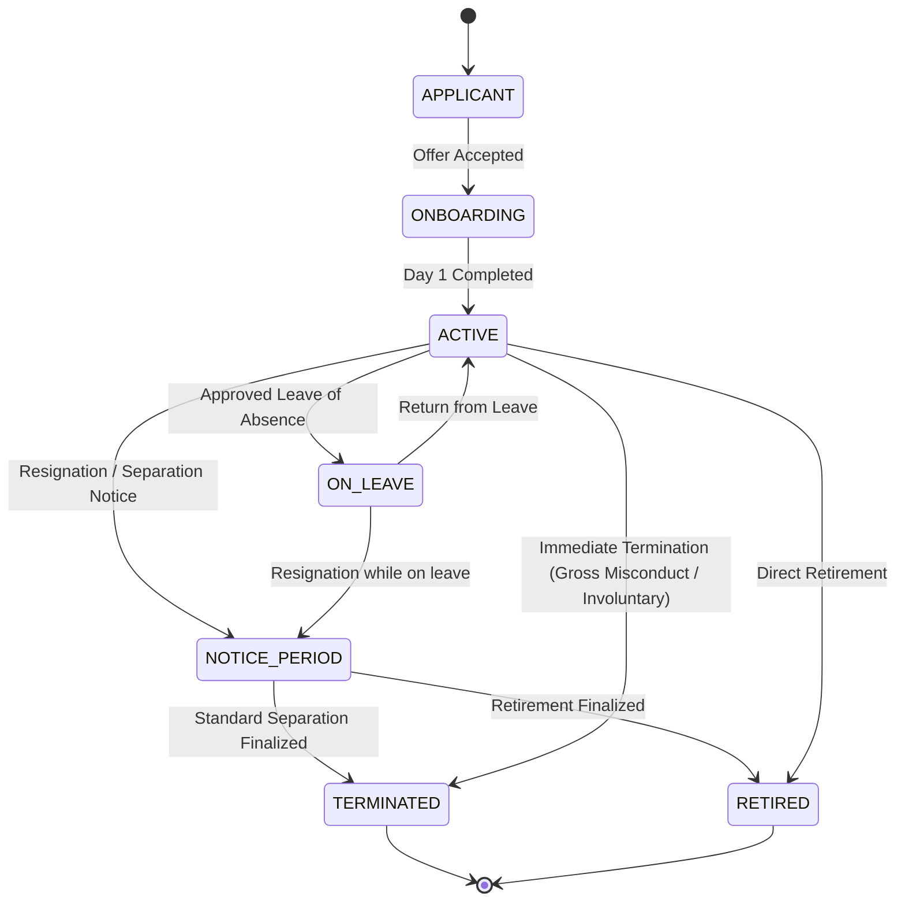
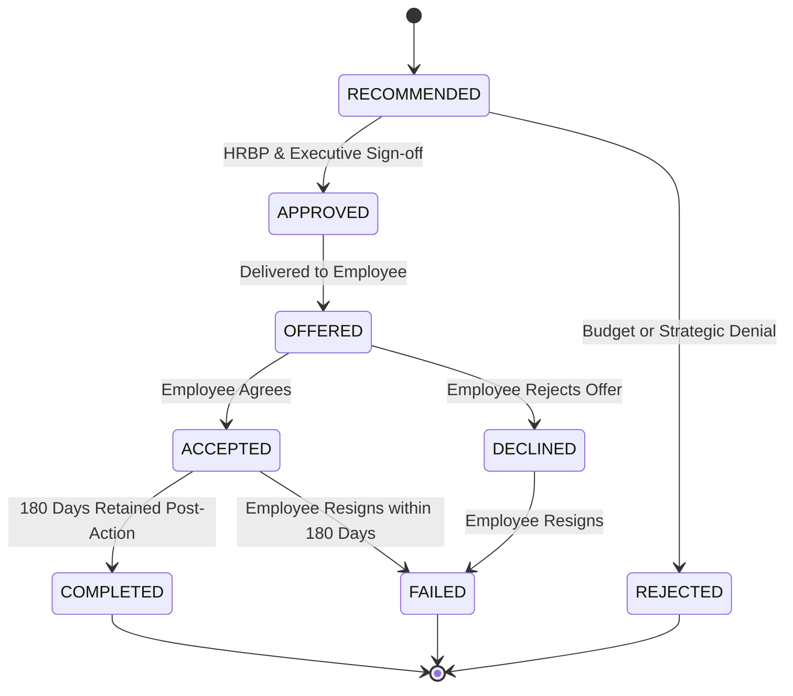

# Workforce Retention Intelligence Platform (WorkforceIQ)
## Business Rules & Data Integrity Specifications

**System Name:** Workforce Retention Intelligence System (`WorkforceIQ`)  
**Organization:** YottaFlex.ai Enterprise Analytics  
**Version:** 1.0.0  
**Phase:** Phase 1 Design Baseline  

---

## 1. Employee Lifecycle State Machine & Transition Rules

The employee lifecycle is governed by an explicit finite-state machine (FSM). Arbitrary state transitions are strictly prohibited by business logic validators and database triggers.



### State Transition Validation Matrix

| Current State | Permitted Next States | Trigger Event | Forbidden Next States & Reason |
| :--- | :--- | :--- | :--- |
| **`APPLICANT`** | `ONBOARDING` | Background check cleared, contract executed. | `ACTIVE` (Cannot bypass onboarding protocols), `TERMINATED`. |
| **`ONBOARDING`** | `ACTIVE` | Formal orientation completed, IT equipment provisioned. | `TERMINATED` (Must transition through proper offboarding). |
| **`ACTIVE`** | `ON_LEAVE`, `NOTICE_PERIOD`, `TERMINATED`, `RETIRED` | Approved absence, formal resignation, severance, or retirement. | `APPLICANT`, `ONBOARDING`. |
| **`ON_LEAVE`** | `ACTIVE`, `NOTICE_PERIOD`, `TERMINATED` | Resumption of duties, formal resignation, or mutual separation. | `APPLICANT`, `ONBOARDING`. |
| **`NOTICE_PERIOD`**| `TERMINATED`, `RETIRED` | Final working day reached, settlement finalized. | `ACTIVE` (Rescinding notice requires formal HR Executive approval). |
| **`TERMINATED`** | *Terminal State* | Offboarding complete. Rehire requires new APPLICANT record. | Any direct transition back to `ACTIVE` without a new rehire record. |
| **`RETIRED`** | *Terminal State* | Formal retirement complete. | Any direct transition back to `ACTIVE`. |

---

## 2. Temporal Data Integrity & SCD Type 2 Invariants

To avoid historical distortion and data leakage in predictive models, human capital attributes are tracked using Slowly Changing Dimensions (SCD Type 2).

### Rule BR-TMP-01: Temporal Span Invariant
- For every historical or compensation record: `effective_from <= COALESCE(effective_to, '9999-12-31')`.
- Zero-duration records (`effective_from = effective_to`) are prohibited.

### Rule BR-TMP-02: Single Active Record Uniqueness
- An employee MUST have **exactly one** active current record in `employee_history` and `compensation_records` at any point in time:
  $$\sum \mathbf{1}_{\{ \text{is\_current} = \text{TRUE} \}} = 1 \quad \forall \text{ employee\_id}$$
- Enforced at the database level via a partial unique index:
  ```sql
  CREATE UNIQUE INDEX idx_emp_hist_active_single 
  ON employee_history (employee_id) 
  WHERE is_current = TRUE;
  ```

### Rule BR-TMP-03: Contiguous Non-Overlapping History
- When an employee's title, department, or manager updates on date $T$:
  1. The existing active record's `effective_to` is updated to $T$.
  2. The existing record's `is_current` is updated to `FALSE`.
  3. A new record is inserted with `effective_from = T`, `effective_to = NULL`, and `is_current = TRUE`.
- There must be zero gaps and zero overlaps in the chronological timeline.

---

## 3. Compensation & Pay Band Governance

### Rule BR-COMP-01: Pay Band Adherence
- Base salary for an employee MUST be within the established band for their assigned `grade_level`:
  $$\text{job\_roles.min\_salary} \le \text{compensation\_records.base\_salary} \le \text{job\_roles.max\_salary}$$
- Any salary outside this band triggers **ANOM-03** unless accompanied by an executive exemption code.

### Rule BR-COMP-02: Compa-Ratio Formulation
- Compa-ratio is dynamically calculated as:
  $$\text{Compa-Ratio} = \frac{\text{base\_salary}}{\text{job\_roles.mid\_salary}}$$
- **Evaluation Criteria:**
  - $\text{Compa-Ratio} < 0.80$: Severe pay lag (High flight risk accelerator).
  - $0.80 \le \text{Compa-Ratio} \le 1.20$: Target market competitive range.
  - $\text{Compa-Ratio} > 1.20$: Market premium (Potential compression risk for peers).

### Rule BR-COMP-03: Reason-Driven Adjustment
- Any modification to base salary must document a valid `revision_reason` (`'HIRE'`, `'ANNUAL_REVIEW'`, `'PROMOTION'`, `'RETENTION'`, `'MARKET_ADJUSTMENT'`).
- A `'PROMOTION'` salary revision must be accompanied by an increment in `grade_level`.

---

## 4. Attrition Outcome Consistency Rules

### Rule BR-ATT-01: Separation Record Synchronization
- If an employee's status is set to `'TERMINATED'` or `'RETIRED'`, there MUST exist an associated record in `exit_records` with:
  - `exit_records.separation_date` matching the termination date.
  - `exit_records.separation_type` matching the lifecycle reason.
- If an employee is marked `'ACTIVE'`, no record may exist in `exit_records` for that active tenure period.

### Rule BR-ATT-02: Regret Status Matrix
- The business impact classification (`regret_status`) is determined by the intersection of performance and criticality:

| Performance Rating (Last Evaluation) | Role Criticality / Grade | Regret Status |
| :--- | :--- | :--- |
| `EXCEEDS_EXPECTATIONS` or `OUTSTANDING` | Any Grade Level | **`REGRETTABLE`** (Critical talent loss) |
| `MEETS_EXPECTATIONS` | Grade Level >= 6 (Senior/Lead) | **`REGRETTABLE`** (Core experience loss) |
| `MEETS_EXPECTATIONS` | Grade Level < 6 (Entry/Mid) | **`NON_REGRETTABLE`** (Manageable turnover) |
| `NEEDS_IMPROVEMENT` or `UNSATISFACTORY` | Any Grade Level | **`NON_REGRETTABLE`** (Healthy attrition) |

### Rule BR-ATT-03: Voluntary vs Involuntary Notice Periods
- For `'VOLUNTARY'` separations: Contractual notice period MUST be $\ge 14$ days, unless negotiated exit is documented.
- For `'INVOLUNTARY'` separations: `notice_period_days_served` may be 0 (immediate payment in lieu of notice).

---

## 5. Retention Intervention Workflow & ROI Rules

### Rule BR-INT-01: Flight Risk Intervention Trigger
- An intervention recommendation is automatically proposed when an active employee's predicted flight risk satisfies:
  $$\text{flight\_risk\_prob} \ge 0.65 \quad \text{AND} \quad \text{risk\_tier} \in ('\text{HIGH}', '\text{CRITICAL}')$$
- Proposed interventions must address the top identified SHAP risk driver (e.g., if driver is `compa_ratio_low`, intervention type must be `COMPENSATION_INCREASE` or `RETENTION_BONUS`).

### Rule BR-INT-02: Closed-Loop Intervention Workflow


### Rule BR-INT-03: Retention Return on Investment (ROI)
- The financial ROI of an intervention is evaluated at 180 days post-action:
  $$\text{Replacement Cost Avoided} = 1.5 \times \text{base\_salary}$$
  $$\text{Net Intervention Value} = \text{Replacement Cost Avoided} - \text{cost\_usd}$$
  $$\text{Intervention ROI (\%)} = \frac{\text{Net Intervention Value}}{\text{cost\_usd}} \times 100$$
- If `is_successful = FALSE`, Net Intervention Value is $-\text{cost\_usd}$.

---

## 6. The Four Mandatory Anomaly Scenarios

The system explicitly detects, flags, and quarantines four organizational data anomalies.

### 6.1 Anomaly 1: Post-Termination Activity (`ANOM-01`)
*An offboarded employee records activities (timesheets, project allocations, survey submissions, or payroll) following their official separation date.*

- **Formal Rule (`BR-ANOM-01`):**
  $$\forall \text{ events } E \in \{ \text{project\_assignments}, \text{engagement\_surveys}, \text{compensation\_records} \}:$$
  $$E.\text{activity\_date} \le \text{exit\_records.separation\_date}$$
- **Severity:** `CRITICAL`
- **Quarantine Action:** Offending activity record is flagged with `anomaly_type = 'POST_TERMINATION_ACTIVITY'` and inserted into `data_anomalies`.
- **SQL Verification Logic:**
  ```sql
  SELECT a.assignment_id, a.employee_id, a.start_date, e.separation_date
  FROM project_assignments a
  JOIN exit_records e ON a.employee_id = e.employee_id
  WHERE a.start_date > e.separation_date;
  ```

---

### 6.2 Anomaly 2: Circular Management Hierarchy & Orphan Reporting (`ANOM-02`)
*A supervisor reporting loop exists (e.g. Employee A reports to B, B reports to C, and C reports to A) or an active non-executive employee has no manager.*

- **Formal Rule (`BR-ANOM-02`):**
  1. The organizational hierarchy must be a **Directed Acyclic Graph (DAG)** rooted at the CEO.
  2. Exactly ONE employee (CEO) has `manager_id IS NULL`.
  3. No employee may be their own direct or indirect manager ($A \not\to^+ A$).
- **Severity:** `HIGH`
- **Quarantine Action:** The offending employee hierarchy edge is logged to `data_anomalies` with `anomaly_type = 'CIRCULAR_HIERARCHY'`.
- **SQL Verification Logic (Recursive CTE):**
  ```sql
  WITH RECURSIVE HierarchyCTE AS (
      SELECT employee_id, manager_id, ARRAY[employee_id] AS path, FALSE AS is_cycle
      FROM employees
      WHERE manager_id IS NOT NULL
      UNION ALL
      SELECT e.employee_id, e.manager_id, h.path || e.employee_id, e.employee_id = ANY(h.path)
      FROM employees e
      JOIN HierarchyCTE h ON e.manager_id = h.employee_id
      WHERE NOT h.is_cycle
  )
  SELECT * FROM HierarchyCTE WHERE is_cycle = TRUE;
  ```

---

### 6.3 Anomaly 3: Compensation Inversion & Grade Band Breach (`ANOM-03`)
*An employee's base salary breaches the defined salary range for their job grade, or a junior employee earns substantially higher compensation than their direct supervisor (>25% wage inversion).*

- **Formal Rule (`BR-ANOM-03`):**
  1. $\text{base\_salary} \in [\text{min\_salary}, \text{max\_salary}]$ for the role.
  2. For subordinate $S$ and supervisor $M$: If $\text{grade\_level}_S < \text{grade\_level}_M$, then $\text{base\_salary}_S \le 1.25 \times \text{base\_salary}_M$.
- **Severity:** `MEDIUM`
- **Quarantine Action:** Inserted into `data_anomalies` with `anomaly_type = 'COMPENSATION_INVERSION'`.
- **SQL Verification Logic:**
  ```sql
  -- Grade Band Breach
  SELECT c.compensation_id, c.employee_id, c.base_salary, r.min_salary, r.max_salary
  FROM compensation_records c
  JOIN employees e ON c.employee_id = e.employee_id
  JOIN job_roles r ON e.role_id = r.role_id
  WHERE c.is_current = TRUE 
    AND (c.base_salary < r.min_salary OR c.base_salary > r.max_salary);
  ```

---

### 6.4 Anomaly 4: Conflicting Leave & Billable Project Logging (`ANOM-04`)
*An employee logs billable project hours on dates with approved full-day leave, or logs physically impossible weekly hours (>80 hours/week).*

- **Formal Rule (`BR-ANOM-04`):**
  1. For dates where `time_off_records.is_approved = TRUE`, billable hours MUST equal 0.
  2. Individual weekly logged hours across all concurrent project assignments: $\sum \text{logged\_hours\_weekly} \le 80.00$.
- **Severity:** `HIGH`
- **Quarantine Action:** Flagged in `data_anomalies` with `anomaly_type = 'LEAVE_HOUR_CONFLICT'`.
- **SQL Verification Logic:**
  ```sql
  SELECT pa.assignment_id, pa.employee_id, pa.logged_hours_weekly, t.leave_type, t.start_date, t.end_date
  FROM project_assignments pa
  JOIN time_off_records t ON pa.employee_id = t.employee_id
  WHERE t.is_approved = TRUE 
    AND (pa.start_date <= t.end_date AND COALESCE(pa.end_date, '9999-12-31') >= t.start_date)
    AND pa.logged_hours_weekly > 0;
  ```

---

## 7. Data Quality & Referential Integrity Gates

| Data Quality Dimension | Check Description | Implementation Layer | Enforcement Mechanism |
| :--- | :--- | :--- | :--- |
| **Completeness** | Mandatory profile fields (names, email, role, department, hire date) cannot be NULL. | Database / Pydantic | `NOT NULL` SQL constraint, Pydantic strict field models. |
| **Referential Integrity**| Orphan foreign keys (e.g. employee referencing nonexistent department) are rejected. | Database | `FOREIGN KEY ... REFERENCES ... ON DELETE RESTRICT`. |
| **Domain Range** | Percentage metrics (burnout, bonus, allocation) must fall strictly within valid bounds. | Database | `CHECK (allocation_pct BETWEEN 1 AND 100)`. |
| **Uniqueness** | Natural keys (email, department name, cost center, active SCD2 records) must be unique. | Database | `UNIQUE` constraints and partial unique indexes. |
| **Timeliness** | Future dates are prohibited for past events (`hire_date <= CURRENT_DATE`). | Application / Schema | Ingestion validator check against current system clock. |
