# Workforce Retention Intelligence Platform (WorkforceIQ)
## Entity-Relationship (ER) Architecture & Relational Schema Diagrams

**System Name:** Workforce Retention Intelligence System (`WorkforceIQ`)  
**Organization:** YottaFlex.ai Enterprise Analytics  
**Version:** 1.0.0  
**Phase:** Phase 1 Design Baseline  

---

## 1. Master Entity-Relationship Diagram (15 Tables)

The master relational diagram models the complete human capital ecosystem, capturing the 10 mandatory core entities alongside history snapshots (SCD Type 2), skills bridges, audit ledgers, leave management, and anomaly quarantine tables.

```mermaid
erDiagram
    %% ==========================================
    %% 1. ORGANIZATIONAL & CORE WORKFORCE
    %% ==========================================
    departments ||--o{ departments : "parent of (hierarchical)"
    departments ||--o{ job_roles : "defines"
    departments ||--o{ employees : "employs"
    departments ||--o{ projects : "sponsors"

    job_roles ||--o{ employees : "assigns"
    job_roles ||--o{ employee_history : "referenced in"

    employees ||--o{ employees : "manages (reports to)"
    employees ||--o{ employee_history : "tracks SCD2 changes"
    employees ||--o{ compensation_records : "compensated by"
    employees ||--o{ performance_evaluations : "evaluated in"
    employees ||--o{ performance_evaluations : "reviews (manager)"
    employees ||--o{ engagement_surveys : "responds to"
    employees ||--o{ project_assignments : "allocated to"
    employees ||--o{ attrition_risk_scores : "scored for flight risk"
    employees ||--o{ retention_interventions : "targeted by"
    employees ||--o| exit_records : "separated via"
    employees ||--o{ employee_skills : "possesses"
    employees ||--o{ time_off_records : "requests"

    skills ||--o{ employee_skills : "categorizes"
    projects ||--o{ project_assignments : "staffs"
    attrition_risk_scores ||--o{ retention_interventions : "triggers"

    %% ==========================================
    %% ENTITY DEFINITIONS & ATTRIBUTES
    %% ==========================================
    departments {
        varchar department_id PK "DEP-ENG-01"
        varchar name UK "Software Engineering"
        varchar division "Product & Engineering"
        varchar cost_center_code UK "CC-ENG-101"
        varchar head_employee_id FK "nullable leader"
        varchar parent_department_id FK "nullable parent"
        numeric annual_budget "annual USD budget"
        timestamptz created_at
        timestamptz updated_at
    }

    job_roles {
        varchar role_id PK "ROLE-SWE-03"
        varchar department_id FK
        varchar title "Senior Staff Engineer"
        int grade_level "1 to 15"
        numeric min_salary "grade minimum"
        numeric mid_salary "market midpoint"
        numeric max_salary "grade maximum"
        boolean is_exempt "FLSA overtime flag"
        timestamptz created_at
        timestamptz updated_at
    }

    employees {
        varchar employee_id PK "EMP-001042"
        varchar first_name "Alice"
        varchar last_name "Smith"
        varchar email UK "alice.smith@yottaflex.ai"
        varchar department_id FK
        varchar role_id FK
        varchar manager_id FK "self-referential"
        employment_status_enum status "ACTIVE, ON_LEAVE, etc."
        employment_type_enum employment_type "FULL_TIME, etc."
        work_location_enum work_location "HYBRID, etc."
        date hire_date
        date probation_end_date
        boolean is_active "operational flag"
        timestamptz created_at
        timestamptz updated_at
    }

    compensation_records {
        uuid compensation_id PK
        varchar employee_id FK
        numeric base_salary "annual gross base"
        numeric bonus_target_pct "0.00 to 100.00"
        int stock_options_granted "shares"
        varchar currency "USD"
        date effective_from
        date effective_to "nullable"
        boolean is_current "SCD2 active flag"
        varchar revision_reason "PROMOTION, etc."
        timestamptz created_at
    }

    performance_evaluations {
        uuid evaluation_id PK
        varchar employee_id FK
        varchar reviewer_id FK "manager"
        varchar evaluation_cycle "2025-H1"
        review_rating_enum rating "EXCEEDS_EXPECTATIONS"
        numeric numeric_score "1.00 to 5.00"
        numeric goals_met_pct "0.00 to 150.00"
        varchar promotion_readiness "READY_NOW"
        text feedback_summary
        date evaluation_date
        timestamptz created_at
    }

    engagement_surveys {
        uuid survey_id PK
        varchar employee_id FK
        date survey_date
        int enps_score "0 to 10"
        int job_satisfaction "1 to 5"
        int work_life_balance "1 to 5"
        int management_trust "1 to 5"
        int career_growth_opps "1 to 5"
        numeric burnout_risk_index "0.00 to 1.00"
        numeric sentiment_score "-1.00 to 1.00"
        timestamptz created_at
    }

    projects {
        varchar project_id PK "PRJ-ALPHA-2025"
        varchar department_id FK
        varchar name "Core AI Platform"
        varchar priority "CRITICAL"
        date start_date
        date end_date
        boolean is_billable
        timestamptz created_at
    }

    project_assignments {
        uuid assignment_id PK
        varchar project_id FK
        varchar employee_id FK
        varchar role_in_project "TECH_LEAD"
        int allocation_pct "1 to 100"
        numeric logged_hours_weekly "weekly billable"
        date start_date
        date end_date
        timestamptz created_at
    }

    attrition_risk_scores {
        uuid score_id PK
        varchar employee_id FK
        date prediction_date
        numeric flight_risk_prob "0.000 to 1.000"
        risk_tier_enum risk_tier "HIGH, CRITICAL"
        varchar model_version "v1.0.0"
        varchar top_driver_1 "compa_ratio_low"
        numeric driver_1_shap_val "0.3200"
        varchar top_driver_2 "overtime_hours"
        numeric driver_2_shap_val "0.1900"
        varchar top_driver_3 "time_in_role"
        numeric driver_3_shap_val "0.1100"
        timestamptz created_at
    }

    retention_interventions {
        uuid intervention_id PK
        varchar employee_id FK
        uuid risk_score_id FK "nullable trigger"
        intervention_type_enum intervention_type "RETENTION_BONUS"
        intervention_status_enum status "RECOMMENDED"
        numeric cost_usd "financial outlay"
        date proposed_date
        date action_date
        date outcome_evaluated_date
        boolean is_successful "retention outcome"
        text hr_notes
        timestamptz created_at
        timestamptz updated_at
    }

    exit_records {
        uuid exit_id PK
        varchar employee_id UK,FK "1:1 with employee"
        date separation_date
        separation_type_enum separation_type "VOLUNTARY"
        regret_status_enum regret_status "REGRETTABLE"
        varchar primary_reason "COMPENSATION"
        varchar secondary_reason "CAREER_GROWTH"
        int notice_period_days_served
        boolean exit_interview_completed
        boolean would_rehire
        varchar destination_industry "Competitor"
        timestamptz created_at
    }

    skills {
        varchar skill_id PK "SKL-PY-01"
        varchar name UK "Python Data Engineering"
        varchar category "Software Engineering"
    }

    employee_skills {
        varchar employee_id PK,FK
        varchar skill_id PK,FK
        int proficiency_level "1 to 5"
        boolean certified_flag
    }

    employee_history {
        uuid history_id PK
        varchar employee_id FK
        varchar department_id FK
        varchar role_id FK
        varchar manager_id FK
        employment_status_enum status
        date effective_from
        date effective_to "nullable"
        boolean is_current "SCD2 flag"
        varchar change_reason "PROMOTION"
        timestamptz created_at
    }

    time_off_records {
        uuid leave_id PK
        varchar employee_id FK
        leave_type_enum leave_type "SICK, ANNUAL"
        date start_date
        date end_date
        boolean is_approved
        numeric total_days
        timestamptz created_at
    }

    data_anomalies {
        uuid anomaly_id PK
        anomaly_type_enum anomaly_type "POST_TERMINATION_ACTIVITY"
        severity_level_enum severity "CRITICAL"
        varchar entity_type "project_assignments"
        varchar entity_id "record PK"
        text description "Integrity rule failure"
        jsonb payload_snapshot "raw row"
        timestamptz detected_at
        boolean is_resolved
        varchar resolved_by
        timestamptz resolved_at
    }

    audit_logs {
        bigserial log_id PK
        varchar table_name
        varchar record_id
        varchar action "INSERT, UPDATE, DELETE"
        jsonb old_values
        jsonb new_values
        varchar actor_id
        varchar client_ip
        timestamptz recorded_at
    }
```

---

## 2. Subdomain Architecture & Relational Mapping

### 2.1 Organizational & Core Human Capital Domain
- **Core Entities:** `departments`, `job_roles`, `employees`, `employee_history`.
- **Relationship Mechanics:**
  - `departments (1) -> job_roles (N)`: Every job role is classified under an organizational business unit.
  - `job_roles (1) -> employees (N)`: Workers are mapped to standardized job titles and grade bands.
  - `employees (1) -> employees (N)`: Recursive parent-child hierarchy representing the management reporting tree. The Chief Executive Officer has `manager_id = NULL`.
  - `employees (1) -> employee_history (N)`: SCD Type 2 ledger documenting every transition of department, role, status, or manager.

### 2.2 Total Rewards & Talent Appraisal Domain
- **Core Entities:** `compensation_records`, `performance_evaluations`.
- **Relationship Mechanics:**
  - `employees (1) -> compensation_records (N)`: Tracks every salary revision, bonus tranche, and stock option grant. One active row per employee enforced by a partial unique index (`is_current = TRUE`).
  - `employees (1) -> performance_evaluations (N)`: Tracks biannual/annual appraisals, objective completion rates (`goals_met_pct`), and promotion readiness.
  - Evaluators are linked back to `employees` (`reviewer_id`), enabling cross-manager appraisal leniency analysis.

### 2.3 Operations, Sentiment & Skills Domain
- **Core Entities:** `projects`, `project_assignments`, `engagement_surveys`, `skills`, `employee_skills`, `time_off_records`.
- **Relationship Mechanics:**
  - `projects (1) -> project_assignments (N) <- employees (1)`: Many-to-many operational bridge capturing staffing allocations, project roles, and weekly logged hours.
  - `skills (1) -> employee_skills (N) <- employees (1)`: Many-to-many competency bridge tracking technical proficiency (1 to 5) and external certifications.
  - `employees (1) -> time_off_records (N)`: Captures statutory and paid leaves to cross-validate operational timesheets against **ANOM-04** (impossible hours / leave conflict).

### 2.4 Predictive Retention & Separation Domain
- **Core Entities:** `attrition_risk_scores`, `retention_interventions`, `exit_records`.
- **Relationship Mechanics:**
  - `employees (1) -> attrition_risk_scores (N)`: Stores batch and real-time ML risk predictions, risk tiers, and individual top SHAP risk drivers.
  - `attrition_risk_scores (0..1) -> retention_interventions (N)`: Links high-risk predictions directly to proactive retention mitigation actions.
  - `employees (1) -> exit_records (0..1)`: Strictly enforces a 1:1 relationship between an employee and their terminal exit record. Pre-termination activity after `separation_date` is strictly audited for **ANOM-01**.

### 2.5 Governance & Quarantine Domain
- **Core Entities:** `data_anomalies`, `audit_logs`.
- **Relationship Mechanics:**
  - Non-intrusive logging architecture: `data_anomalies` operates as a centralized quarantine sink for data validation failures, isolating rogue records from corrupting ML training pipelines.
  - `audit_logs` functions as an append-only transaction ledger capturing pre- and post-image JSON payloads for every database mutation.
